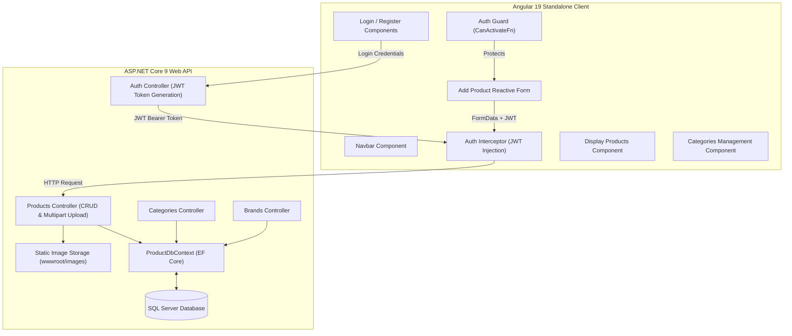

# Full-Stack Inventory Management System (Angular 19 & ASP.NET Core Web API)


An enterprise-grade Full-Stack Inventory and Product Catalog Management System engineered with an **ASP.NET Core Web API (.NET 9)** backend and an **Angular 19 (Standalone Components)** frontend. The application features JWT Bearer authentication, HTTP interceptors, route guards, DTO validation, and multi-part image streaming with GUID collision prevention.

---

## 🌟 Key Features

- **Angular 19 Standalone Architecture:** Built entirely with standalone components (`imports: [...]`), eliminating legacy NgModules for maximum performance and modularity.
- **JWT Authentication & Security:** 
  - Token-based authentication with `AuthService`.
  - Functional **Route Guards (`AuthGuard`)** protecting dashboard and inventory creation routes.
  - **HTTP Interceptors (`AuthInterceptor`)** automatically attaching Bearer tokens to authorized requests.
- **Relational Master-Detail CRUD:** Seamless management of normalized Categories, Brands, and Products with dynamic parent-child selection.
- **Reactive Forms & Image Preview:** Reactive Angular forms (`FormGroup`, `FormControl`) with real-time client-side image preview before submission.
- **Zero-Collision Photo Uploads:** Backend streams files via `multipart/form-data`, generating unique GUID filenames stored in `wwwroot/images`.
- **Entity Framework Core 9:** Database-driven schema with automated migrations and seed configurations.

---

## 🏗️ Architecture & Component Flow



---

## 📂 Repository Layout

```
MYOwnExamAPI+Client/
├── InventoryAPI/                              # ASP.NET Core Web API
│   └── InventoryAPIProjectSln/
│       └── InventoryAPIProject/
│           ├── Controllers/                  # Auth, Brands, Categories, Products
│           ├── DTOs/                         # AuthResponseDto, BrandDto, LoginDto, ProductDto
│           ├── Migrations/                   # EF Core Code-First migrations
│           ├── Models/                       # ApplicationUser, Brand, Category, Product
│           ├── wwwroot/images/               # Uploaded product image storage
│           ├── Program.cs                    # DI, CORS configuration, JWT pipeline
│           └── appsettings.json              # Connection strings & JWT config
└── InventoryClient/                           # Angular 19 Client
    └── InventoryClientProject/
        └── src/app/
            ├── components/
            │   ├── add-product/              # Reactive product creation form + image preview
            │   ├── categories/               # Category CRUD view
            │   ├── display-products/         # Product catalog grid with cards & badges
            │   ├── login/                    # Login authentication view
            │   ├── navbar/                   # Responsive navigation bar
            │   └── register/                 # New user registration view
            ├── guards/                       # auth-guard.ts
            ├── interceptors/                 # auth-interceptor.ts
            ├── models/                       # TypeScript interfaces (Product, Category, etc.)
            └── services/                     # auth-service.ts, product-service.ts, etc.
```

---

## ⚙️ Quick Start Guide

### Prerequisites
- [.NET 9.0 SDK](https://dotnet.microsoft.com/download/dotnet/9.0)
- [Node.js](https://nodejs.org/) (v20+) & [Angular CLI](https://angular.dev/)
- [Microsoft SQL Server](https://www.microsoft.com/sql-server)

---

### Step 1: Start the Backend (.NET 9 Web API)
```bash
cd InventoryAPI/InventoryAPIProjectSln/InventoryAPIProject
dotnet restore
dotnet ef database update
dotnet run
```
*API will run at `https://localhost:7198` / `http://localhost:5298`.*

---

### Step 2: Start the Frontend (Angular 19)
```bash
cd InventoryClient/InventoryClientProject
npm install
npm start
```
*Navigate your browser to `http://localhost:4200`.*

---

## 👤 Author
**A.H.M. Zafir Hasan**  
Full-Stack Developer • .NET, Mobile & Web Systems  
- **GitHub:** [@Zafff-e](https://github.com/Zafff-e)  
- **Portfolio:** [zafff-e.github.io](https://zafff-e.github.io)  
- **LinkedIn:** [zafir-hasan-developer](https://linkedin.com/in/zafir-hasan-developer)
