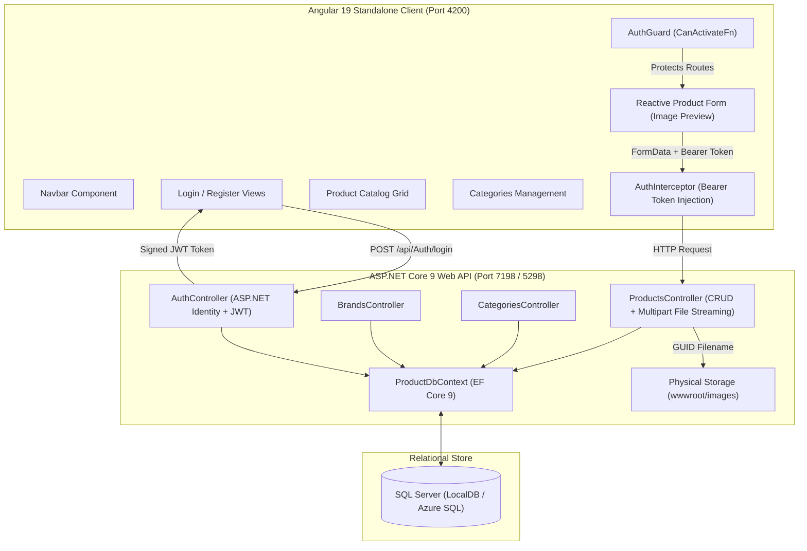
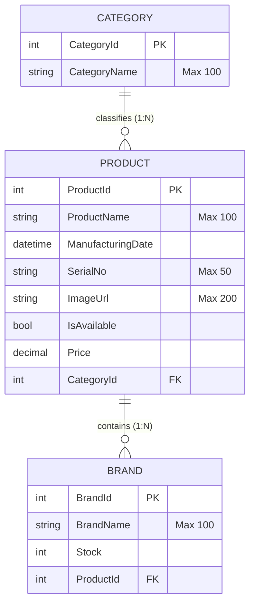

# Full-Stack Inventory Management System (Angular 19 & ASP.NET Core Web API)

[](https://dotnet.microsoft.com/)
[](https://learn.microsoft.com/en-us/dotnet/csharp/)
[-DD0031?logo=angular&logoColor=white)](https://angular.dev/)
[](https://www.typescriptlang.org/)
[](https://learn.microsoft.com/en-us/ef/core/)
[-success?logo=xunit&logoColor=white)](https://xunit.net/)
[](https://www.microsoft.com/sql-server)
[](LICENSE)

An enterprise-grade, decoupled Full-Stack Inventory and Product Catalog Management System engineered with an **ASP.NET Core Web API (.NET 9)** backend and an **Angular 19 (Standalone Components)** frontend. The application features JWT Bearer authentication, HTTP request interceptors, functional route guards, master-detail relational synchronization, reactive form validations, zero-collision multipart image streaming, and automated xUnit unit testing.

---

## 1. Domain Problem & Architecture Overview

Inventory control systems in modern commercial and hardware enterprises require accurate tracking of hierarchical product categories, affiliated brand manufacturers, stock counts, and physical assets. Common engineering hurdles in such systems include:
- **Master-Detail Relationship Corruption:** Cascading child updates (e.g. updating brands under an existing product) often suffer from foreign key severing, orphaned records, or accidental deletion of unchanged child rows.
- **Image Asset Drift:** Incomplete file cleanup leaves orphaned binary image files on the server when products are updated or removed.
- **Frontend-Backend Decoupling Challenges:** Securing single-page applications against unauthorized access while seamlessly propagating bearer tokens across asynchronous HTTP requests.

This project addresses these challenges with clean enterprise patterns:
1. **Normalized 3-Tier Entity Model:** Categories -> Products -> Brands with foreign key constraints and cascade deletion policies.
2. **Transactional Master-Detail Synchronization:** A dynamic diffing algorithm in the `PUT /api/Products/{id}` endpoint that identifies deleted child brands, updates existing ones, and persists newly added brands while preserving parent foreign key integrity.
3. **Collision-Resistant Multipart Streaming:** Uploaded product images are assigned cryptographically random GUID filenames in `wwwroot/images`, with automated disk cleanup removing stale files on update or delete.
4. **Modern Angular 19 Standalone Architecture:** Completely free of legacy `NgModule` declarations, leveraging tree-shakable standalone components, functional route guards (`CanActivateFn`), and functional HTTP interceptors (`HttpInterceptorFn`).

---

## 2. System Architecture & Data Flow



---

## 3. Relational Entity Schema & Master-Detail Sync



### Master-Detail Brand Sync Algorithm (`PUT /api/Products/{id}`)
When updating a product with associated brands:
1. **Entity Inclusion:** Eagerly loads existing product and child collection via `.Include(p => p.Brands)`.
2. **Orphan Identification:** Calculates `brandsToRemove = existingProduct.Brands.Where(e => !newBrands.Any(u => u.BrandId == e.BrandId))` and marks them for removal via `_db.Brands.RemoveRange()`.
3. **In-Place Modification:** Matches existing child brands by primary key `BrandId`, applying `_db.Entry(existing).CurrentValues.SetValues(updateBrand)`.
4. **Foreign Key Enforcement:** Explicitly assigns `updateBrand.ProductId = id` before child insertion, preventing detached or zero-keyed child records.
5. **Asset Cleanliness:** Compares new image filename with old filename; automatically deletes the obsolete file from physical disk storage.

---

## 4. API Endpoints Specification

| Method | Endpoint | Authentication | Description |
| :--- | :--- | :---: | :--- |
| **POST** | `/api/Auth/register` | Anonymous | Registers a new user with ASP.NET Core Identity and assigns role claims. |
| **POST** | `/api/Auth/login` | Anonymous | Validates credentials and returns signed JWT token, expiration, and user roles. |
| **GET** | `/api/Categories` | Public | Retrieves all product categories. |
| **GET** | `/api/Categories/{id}` | Public | Retrieves specific category by primary key. |
| **POST** | `/api/Categories` | Bearer JWT | Creates a new category. |
| **PUT** | `/api/Categories/{id}` | Bearer JWT | Modifies category details. |
| **DELETE** | `/api/Categories/{id}` | Bearer JWT | Removes category. |
| **GET** | `/api/Brands` | Public | Retrieves all brands across the system. |
| **GET** | `/api/Brands/{id}` | Public | Retrieves brand by ID. |
| **POST** | `/api/Brands` | Bearer JWT | Creates brand. |
| **PUT** | `/api/Brands/{id}` | Bearer JWT | Updates brand name or stock count. |
| **DELETE** | `/api/Brands/{id}` | Bearer JWT | Removes brand. |
| **GET** | `/api/Products` | Public | Retrieves all products with scalar details. |
| **GET** | `/api/Products/{id}` | Public | Retrieves single product by ID. |
| **GET** | `/api/Products/{id}/Include` | Public | Retrieves product eager-loading parent Category and associated Brands. |
| **POST** | `/api/Products` | Bearer JWT | Persists new product and associated brands with fallback default image. |
| **POST** | `/api/Products/Upload` | Bearer JWT | Uploads image file; validates MIME type and 2MB limit; returns GUID filename. |
| **POST** | `/api/Products/Upload/{id}` | Bearer JWT | Direct upload replacing image for existing product and purging stale file. |
| **PUT** | `/api/Products/{id}` | Bearer JWT | Synchronizes product details and transactional master-detail child brands. |
| **DELETE** | `/api/Products/{id}` | Bearer JWT | Cascades deletion of product, child brands, and associated image asset. |

---

## 5. Automated Test Suite (22 Tests, 100% Pass)

The backend is backed by an automated **xUnit** test suite (`InventoryAPI.Tests`) executing against an in-memory database and mock server environments:

```bash
$ dotnet test InventoryManagement.sln

Passed!  - Failed: 0, Passed: 22, Skipped: 0, Total: 22, Duration: 1 s - InventoryAPI.Tests.dll (net9.0)
```

### Test Coverage Matrix
| Test Suite File | Tests | Key Scenarios Verified |
| :--- | :---: | :--- |
| **`CategoriesControllerTests.cs`** | 6 | All categories retrieval, single category lookup by ID, 404 NotFound on missing ID, category creation (`CreatedAtAction`), in-place update, ID mismatch rejection (BadRequest), and deletion. |
| **`BrandsControllerTests.cs`** | 6 | Full brands list, single brand lookup, 404 handling, brand insertion, brand modification, and brand deletion. |
| **`ProductsControllerTests.cs`** | 7 | Eager loading with `Include` (Category & Brands), default image fallback (`noimage.png`), product insertion, **transactional master-detail child sync (removing deleted child brands while modifying existing ones)**, and product deletion with disk asset removal. |
| **`AuthControllerTests.cs`** | 3 | Unauthorized response on unknown user, successful JWT generation with claims and expiration on valid credentials, and duplicate username rejection. |

---

## 6. Repository Layout

```
MYOwnExamAPI+Client/
|-- InventoryManagement.sln                    # Root master solution (API + Tests)
|-- InventoryAPI/                              # ASP.NET Core 9 Web API
|   +-- InventoryAPIProjectSln/
|       |-- InventoryAPIProjectSln.sln
|       |-- InventoryAPIProject/
|       |   |-- Controllers/                   # Auth, Brands, Categories, Products
|       |   |-- DTOs/                          # AuthResponseDto, BrandDto, LoginDto, ProductDto
|       |   |-- Migrations/                    # EF Core Code-First migrations
|       |   |-- Models/                        # ApplicationUser, Brand, Category, Product, ProductDbContext
|       |   |-- wwwroot/images/                # Static image storage (noimage.png)
|       |   |-- Program.cs                     # DI, CORS, JWT pipeline, Swagger
|       |   |-- appsettings.json               # Sanitized production configuration
|       |   +-- appsettings.Development.json   # Local development JWT keys
|       +-- InventoryAPI.Tests/                # xUnit Automated Test Suite (.NET 9)
|           |-- CategoriesControllerTests.cs   # 6 tests
|           |-- BrandsControllerTests.cs       # 6 tests
|           |-- ProductsControllerTests.cs     # 7 tests (master-detail sync verification)
|           |-- AuthControllerTests.cs         # 3 tests
|           +-- TestDbContextFactory.cs        # In-memory database isolation factory
|-- InventoryClient/                           # Angular 19 Frontend
|   +-- InventoryClientProject/
|       |-- angular.json                       # Angular CLI configuration
|       |-- package.json                       # Angular 19 dependencies & scripts
|       +-- src/app/
|           |-- components/
|           |   |-- add-product/               # Reactive form + image preview
|           |   |-- categories/                # Category CRUD view
|           |   |-- display-products/          # Product catalog card grid
|           |   |-- login/                     # Authentication view
|           |   |-- navbar/                    # Dynamic auth-aware navigation
|           |   +-- register/                  # Registration view
|           |-- guards/                        # auth-guard.ts (CanActivateFn)
|           |-- interceptors/                  # auth-interceptor.ts (Bearer injection)
|           |-- models/                        # TypeScript domain interfaces
|           +-- services/                      # auth-service.ts, product-service.ts
+-- README.md                                  # Enterprise engineering documentation
```

---

## 7. Setup & Local Execution Guide

### Prerequisites
- [.NET 9.0 SDK](https://dotnet.microsoft.com/download/dotnet/9.0)
- [Node.js](https://nodejs.org/) (v20+) & [npm](https://www.npmjs.com/)
- [Microsoft SQL Server LocalDB](https://learn.microsoft.com/en-us/sql/database-engine/configure-windows/sql-server-express-localdb)

---

### Step 1: Run Automated Backend Tests
```bash
# Execute all 22 tests from root
dotnet test InventoryManagement.sln
```

---

### Step 2: Start the Web API Backend
```bash
cd InventoryAPI/InventoryAPIProjectSln/InventoryAPIProject
dotnet run
```
- API will launch at: `https://localhost:7198` / `http://localhost:5298`
- Swagger UI interactive documentation: `https://localhost:7198/swagger`
- Default seeded administrator: `admin` / `Admin@123456`

---

### Step 3: Start the Angular 19 Frontend
```bash
cd InventoryClient/InventoryClientProject
npm install
npm start
```
- Client application will serve at: `http://localhost:4200`

---

## 8. Technical Interview Discussion Points

- **Why Standalone Components instead of NgModules?**
  Angular 19 standalone components simplify the mental model by directly declaring component dependencies in their `imports: [...]` array. This improves tree-shaking, decreases initial bundle size, and allows granular code splitting per route.
- **Why dynamic child synchronization in HTTP PUT instead of blind wipe-and-reinsert?**
  A naive wipe-and-reinsert approach deletes all child brands and creates new ones with new primary keys on every update, which breaks database foreign key references from order lines or audit tables and creates needless transaction lock contention. The diffing algorithm preserves unchanged rows and their primary keys.
- **How is image upload collision prevented?**
  Image filenames are generated using `Path.GetRandomFileName()` combined with the original file extension. Uploaded files undergo MIME type verification (JPEG, PNG, WEBP, GIF) and 2MB payload boundary enforcement before being committed to disk.

---

## 9. Author & Scholarship Information

**A.H.M. Zafir Hasan**  
*Trainee ID:* `1294926` | *Batch:* `CS/SCSL-A/70/01`  
*Programme:* IsDB-BISEW IT Scholarship Programme (Round 70, ESAD-CS / WADA)  
- **GitHub:** [@Zafff-e](https://github.com/Zafff-e)  
- **Portfolio:** [zafff-e.github.io](https://zafff-e.github.io)  
- **LinkedIn:** [zafir-hasan-developer](https://linkedin.com/in/zafir-hasan-developer)
